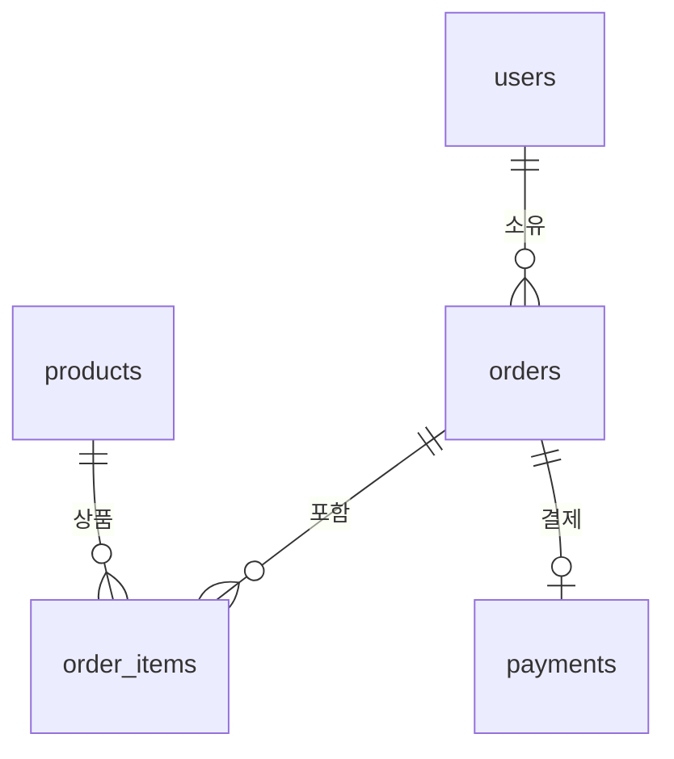

# 쇼핑몰 ERD

회원, 상품, 장바구니·주문, 주문 상품, 결제 결과를 다섯 테이블로 관리합니다.

위 다이어그램은 [erd.mmd](erd.mmd)와 같은 내용입니다. Mermaid 렌더링을 지원하는 Markdown 미리보기에서 볼 수 있으며, `.mmd` 파일은 Mermaid 지원 도구에서 직접 열 수 있습니다.

- 회원 한 명은 여러 장바구니·주문을 가질 수 있습니다. 활성 장바구니는 회원당 하나입니다.
- 장바구니·주문 하나에는 여러 상품 항목이 들어갑니다.
- 상품 하나는 여러 주문 항목에 포함될 수 있습니다.
- 주문 하나에는 결제 결과가 없거나 하나 있습니다.

상세 컬럼은 [테이블 정의서](table-definition.md), 데이터 변화는 [상품 구매 시뮬레이션](purchase-simulation.md)을 참고하세요.
